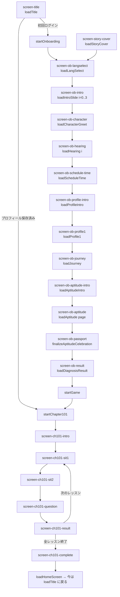

# 画面フロー

画面はすべて `index.html` の `<section id="screen-...">` です。各画面に「ローダー関数」が1つずつあり、`goTo(ローダー)` で表示します。

## メインの流れ

## 画面の一覧
| 画面ID | ローダー | ファイル | 内容 |
|---|---|---|---|
| `screen-title` | `loadTitle` | app.ts | タイトルとログインボタン |
| `screen-story-cover` | `loadStoryCover` | onboarding.ts | プログラム全体の導入 |
| `screen-ob-langselect` | `loadLangSelect` | onboarding.ts | 日本語レベルと表示言語の選択 |
| `screen-ob-intro` | `loadIntroSlide(i)` | onboarding.ts | 紹介カルーセル（`introSlides`） |
| `screen-ob-character` | `loadCharacterGreet` | onboarding.ts | AIチューターのあいさつ |
| `screen-ob-hearing` | `loadHearing(i)` | onboarding.ts | ヒアリング（`hearings`） |
| `screen-ob-schedule-time` | `loadScheduleTime` | onboarding.ts | 学習する時間帯と通知の設定 |
| `screen-ob-profile-intro` | `loadProfileIntro` | onboarding.ts | プロフィール入力の導入 |
| `screen-ob-profile1` | `loadProfile1` | onboarding.ts | 名前・性別・生年月日・アバターの入力 |
| `screen-ob-journey` | `loadJourney` | onboarding.ts | 学習ステップ（扉）の紹介（`journeySteps`） |
| `screen-ob-aptitude-intro` | `loadAptitudeIntro` | onboarding.ts | 適性診断の導入 |
| `screen-ob-aptitude` | `loadAptitude(page)` | onboarding.ts | 適性診断（1ページに3問、`APTITUDE_PAGE_SIZE`） |
| `screen-ob-passport` | `finalizeAptitudeCelebration` / `finalizeOnboarding` | onboarding.ts | SHOSAパスポートの完成演出 |
| `screen-ob-result` | `loadDiagnosisResult` | onboarding.ts | 診断結果 |
| `screen-ch101-intro` | `startChapter101` | app.ts | 第1章のガイド（`CH1_DATA.guide`） |
| `screen-ch101-sit1` / `-sit2` | `renderCh101Sit1/2` | app.ts | 状況の説明と会話 |
| `screen-ch101-question` | `renderCh101Question` | app.ts | A/B の2択問題 |
| `screen-ch101-result` | `renderCh101Result` | app.ts | 正解か不正解かと、その理由 |
| `screen-ch101-complete` | `finalizeCh101Complete` | app.ts | 第1章のクリア画面（`CH1_DATA.end`） |
| `screen-home` | `loadHomeScreen` | app.ts | **デザイン中のため使っていません**（タイトル画面に戻します） |
| `screen-settings` | `loadSettings` | onboarding.ts | プロフィール編集、やり直し、リセット |
| `screen-day-start` | `loadDayStart(idx)` | app.ts | 本編 Day の開始画面（`idx=0` のときは第1章へ移動） |
| `screen-event-intro` | `loadEventIntro` | app.ts | Day の導入 |
| `screen-dialogue` | `loadDialogue` | app.ts | 会話 |
| `screen-question` | `loadQuestion` | app.ts | 3択問題（`selectChoice(i)`） |
| `screen-result` | `loadResult` | app.ts | 結果とスコアの変化 |
| `screen-explanation` | `loadExplanation` | app.ts | SHOSA の解説 |
| `screen-voice` | `loadVoice` | app.ts | 発音練習 |
| `screen-game-over` | `loadGameOver` | app.ts | 総合結果 |

## 補足
- 今のメインの学習体験は **0章 → 第1章（ch101、`CH1_DATA`）** です。
- 本編の Day の流れ（`GAME_DATA`、`screen-day-start` から `screen-game-over` まで）は以前の作りが残っているもので、`dayIndex >= 1` のときだけ使われます。
- `showScreen()` の中で、画面IDによってヘッダーの表示が自動で切り替わります。
  - `GAME_PLAY_SCREENS` に入っている画面では `#game-header` を表示します。
  - `screen-ob-*`、`screen-ch101-*`、タイトル画面、ホーム画面では `#top-nav-bar` を隠します。
